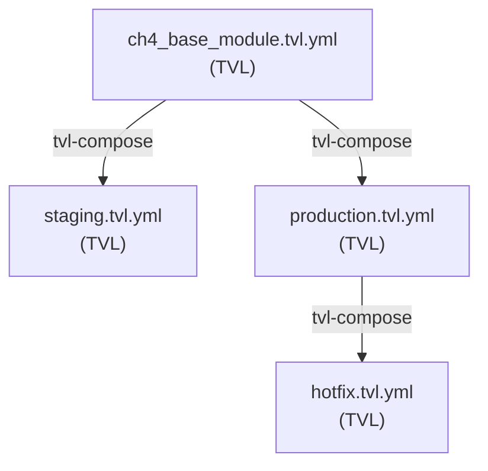

# Chapter 4 · Patterns for Real Deployments

Managing multiple environments (dev, staging, production) often requires slight variations of the same TVL
spec. This chapter covers module composition patterns using `tvl-compose`, a preprocessing tool that flattens
overlay files into valid TVL modules.

## Module Composition with tvl-compose

The TVL core schema defines standalone, self-contained modules. To support inheritance and overlays,
we use **preprocessing** rather than extending the core schema:

```text
ch4_base_module.tvl.yml + ch4_staging.overlay.yml  →  tvl-compose  →  staging.tvl.yml (a TVL module)
```

This keeps the core spec simple while enabling powerful composition patterns.

## Layered Specifications

**Base module** (valid TVL):

```yaml
# ch4_base_module.tvl.yml - full TVL module (file in tvl_book/examples/)
tvl:
  module: corp.support.rag_bot

environment:
  snapshot_id: "2025-01-20T00:00:00Z"
  bindings:
    llm_gateway: us-east-1

evaluation_set:
  dataset: s3://datasets/book/overlays/base.jsonl
  seed: 2025

tvars:
  - name: model
    type: enum[str]
    domain: ["gpt-4o-mini", "gpt-4o", "claude-3-haiku"]
  - name: temperature
    type: float
    domain:
      range: [0.0, 1.0]
      resolution: 0.05
  - name: retriever.k
    type: int
    domain:
      range: [0, 20]

constraints:
  structural:
    - when: "retriever.k >= 12"
      then: "temperature <= 0.4"
  derived: []

objectives:
  - name: quality
    metric_ref: metrics.quality.v1
    direction: maximize
  - name: latency_p95_ms
    metric_ref: metrics.latency_p95_ms.v1
    direction: minimize
  - name: cost_usd
    metric_ref: metrics.cost_usd.v1
    direction: minimize

promotion_policy:
  dominance: epsilon_pareto
  alpha: 0.05
  adjust: holm
  min_effect:
    quality: 0.01
    latency_p95_ms: 50
    cost_usd: 0.001

# Legacy exploration hints: deprecated in the schema and not part of TVL semantics
exploration:
  strategy:
    type: nsga2
  budgets:
    max_trials: 200
    max_wallclock_s: 7200
```

**Staging overlay** (NOT a standalone TVL module):

```yaml
# ch4_staging.overlay.yml - requires preprocessing (file in tvl_book/examples/)
_tvl_overlay:
  extends: ch4_base_module.tvl.yml

overrides:
  evaluation_set:
    dataset: s3://datasets/book/overlays/staging.jsonl
  tvars:
    - name: temperature
      domain:
        range: [0.0, 0.6]
        resolution: 0.05
  exploration:
    budgets:
      max_trials: 100  # Reduced for faster CI
      max_wallclock_s: 3600
```

**Compose to valid TVL:**

```bash
cd tvl_book/examples
tvl-compose ch4_staging.overlay.yml -o staging.tvl.yml
tvl-validate staging.tvl.yml  # Schema + lint checks passed.
```

## Visualizing Overlays



Each composed output is a standalone TVL module. Composition checks narrowing rules (below), not the schema:
run `tvl-validate` on the output, or pass `tvl-compose --validate`, to confirm it is valid. Overlays are inputs to
the composition process, not runtime artifacts.

## Override Rules

By default `tvl-compose` checks a fixed list of narrowing rules. They do not prove that an overlay cannot loosen
anything. The main rules (full list in the [language reference](../../../docs/reference/language.md#overlay-narrowing-checks)):

| Override Type | Allowed | Not Allowed |
|--------------|---------|-------------|
| Enum domain | Remove values | Add new values |
| Numeric range | Narrow bounds | Widen bounds |
| Budget (`exploration.budgets`) | Decrease | Increase beyond base |
| TVARs | Keep (domains may narrow as above) | Add new TVARs |
| Objectives | Keep | Drop, flip direction, widen a band |
| Chance constraints | Lower `threshold`, raise `confidence` | Drop, or loosen either value |
| Structural / derived clauses | Keep, or replace with a strictly tighter bound | Drop, unless explicitly waived |

!!! info "Current Validation Scope"
    Some changes are not checked and need review by hand: domain-shape and resolution changes,
    `promotion_policy.alpha`, `adjust` and `min_effect`, `evaluation_set.dataset` and `seed`,
    `environment` values, and `objectives[].metric_ref`. Waivers allow explicit clause removal.
    `--no-validate` skips the narrowing checks.

## Hotfix Playbook

Need to react quickly to a vendor outage? Create a short-lived overlay:

```yaml
# hotfix-vendor-outage.overlay.yml
_tvl_overlay:
  extends: ch4_production.overlay.yml

overrides:
  tvars:
    - name: model
      domain: ["gpt-4o-mini"]  # Narrow to the safest known-good model
```

Compose and deploy:

```bash
tvl-compose hotfix-vendor-outage.overlay.yml -o hotfix.tvl.yml
tvl-validate hotfix.tvl.yml
# Deploy hotfix.tvl.yml
```

!!! pitfall "Avoid Configuration Drift"
    Never edit the base file for a temporary fix—create an overlay. This keeps history clean and makes it
    obvious which changes were incident driven versus long-term strategy.

## Provenance Matters

Every promotion should commit:

- `spec.tvl.yml` — the composed, valid TVL module.
- `spec.overlay.yml` — the overlay that produced it (if any).
- `provenance.json` — metadata: base SHA, overlay SHA, compose timestamp.

```json
{
  "base": "base.tvl.yml@abc123",
  "overlay": "staging.overlay.yml@def456",
  "composed_at": "2025-01-15T10:30:00Z",
  "composed_by": "ci-bot"
}
```

This audit trail enables deterministic recreation of exact configurations from version control history.
