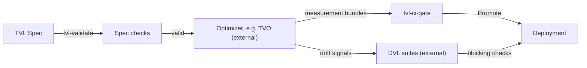

# Chapter 5 · Integration and Tooling

TVL earns its keep when paired with tools that consume it. In this book those are TVO (the TVL Optimizer in the
Traigent platform) and DVL (a data-validation layer). Neither is part of the TVL language. TVO reads TVL specs,
searches the configuration space, and produces measurement bundles for candidate configurations. The TVL promotion
gate (`tvl-ci-gate`) then decides from that evidence whether a candidate is promoted. DVL checks the evaluation
datasets behind those measurements, so a good-looking configuration is not shipped on stale data. Any optimizer or
agent platform can play TVO's role; see the
[Traigent integration guide](../../../docs/guides/traigent-tvl-integration.md) for the split of responsibilities.



## TVL CLI Tools

The TVL toolchain provides focused CLI tools for validation and CI integration:

| Tool | Purpose |
|------|---------|
| `tvl-parse` | Parse YAML to JSON AST, basic syntax checking |
| `tvl-lint` | Normative lints: missing min_effect, duplicate TVARs, etc. |
| `tvl-validate` | JSON Schema + lint validation (combines parse + lint) |
| `tvl-check-structural` | SAT/SMT satisfiability of structural constraints |
| `tvl-check-operational` | Static check of derived preconditions against the declared environment, plus budget positivity (it does not estimate cost or observe a run) |
| `tvl-config-validate` | Check a configuration assignment against spec domains |
| `tvl-measure-validate` | Validate measurements against spec + promotion policy |
| `tvl-ci-gate` | Offline promotion gate: compares incumbent and candidate measurement bundles under the module's promotion policy, prints `Promote`, `Reject`, `NoDecision` or `Error`, and exits 0 only for `Promote` |
| `tvl-compose` | Flatten overlay files into TVL modules (`--validate` also runs schema + lint checks) |
| `tvl-compile-runtime` | Compile a module or pack into a version-tagged runtime contract and local artifacts |
| `tvl-microsim-bridge` | Export Orientation RAG MicroSim presets (reads a legacy `configuration_space` block, not `tvars`) |

### Quick Validation

```bash
# Validate schema and run lints
tvl-validate my-spec.tvl.yml

# Check structural constraints are satisfiable
tvl-check-structural my-spec.tvl.yml

# Full CI pipeline (validation only)
tvl-validate my-spec.tvl.yml && \
  tvl-check-structural my-spec.tvl.yml
```

### Configuration and Measurement Validation

```bash
# Validate a specific configuration against the spec
tvl-config-validate my-spec.tvl.yml config.yml

# Validate configuration + measurements for promotion gate
tvl-measure-validate my-spec.tvl.yml config.yml measurements.yml
```

## Deterministic Artifacts

Validation tools such as `tvl-validate` and `tvl-measure-validate` check these files; they do not produce the
configuration, measurements, or provenance. An integration should keep the following files together, in a
deterministic form, for auditability:

- `spec.tvl.yml` — the validated TVL module
- `config.yml` — the promoted configuration assignment
- `measurements.yml` — evaluation results (metrics, sample sizes)
- `provenance.json` — metadata (timestamps, runners, environment snapshot)

## Field Notes · Replay the Optimization Story

The Orientation RAG lab is a toy model with three presets. Jump between **Baseline**, **Latency Spike**, and
**Budget Shift** to see how objectives trade off as conditions change.

<iframe src="../microsims/orientation-rag-circuit/main.html#budget-shift" height="640px" scrolling="no" style="width: 100%; border: none;"></iframe>

- Compare the latency and cost read-outs before and after each preset.
- Click **Copy YAML** to capture a simulation snapshot of the slider values. It is not a schema-valid TVL
  configuration or a TVO export.
- The badges test simple latency, cost, and rerank thresholds. They are not promotion-gate evidence: a real gate
  decides from measured evidence for the incumbent and the candidate (see the CI recipe below).

!!! integration "CI Recipe"
    ```bash
    # 1. Validate the spec
    tvl-validate path/to/spec.tvl.yml

    # 2. Check constraints are satisfiable
    tvl-check-structural path/to/spec.tvl.yml

    # 3. Run optimization with your optimizer (illustrative command; not a TVL tool)
    your-optimizer --spec path/to/spec.tvl.yml --output results/

    # 4. Validate promotion candidate
    tvl-measure-validate path/to/spec.tvl.yml results/config.yml results/measurements.yml

    # 5. Run promotion gate (compare incumbent vs candidate)
    tvl-ci-gate path/to/spec.tvl.yml results/incumbent.yml results/candidate.yml --json

    # 6. Data quality check (DVL; illustrative command, not a TVL tool)
    dvl validate suites/faq-orientation.json
    ```

## Manifests and Promotion

After an optimization run, an integration can emit a manifest bundling the items below (see the illustrative
[`ch5_integration_manifest.yaml`](../../examples/ch5_integration_manifest.yaml)):

- Resolved spec SHA and artifact locations
- Validation logs from the CLI tools
- Promotion gate decision (`Promote`, `Reject`, `NoDecision`, or `Error`)
- DVL drift checks (pass/fail with links)
- Rollback instructions if thresholds regress

Treat the manifest as a living audit trail. Every deployment should point to it.
