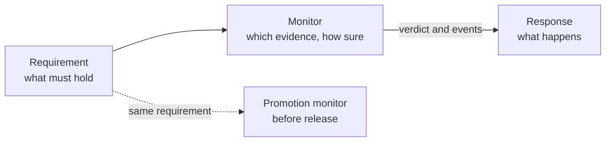

# Chapter 6 · Requirements in Production

Chapters 2 to 5 got a configuration to the promotion gate: it was in the allowed design space, and the evidence said it was
no worse than the incumbent. Then it went live, and nobody was asking the next question: **what must the agent keep doing
tomorrow, and what happens when it stops?**

TVL 1.3 answers with three small blocks. A **requirement** says what must hold. A **monitor** says which evidence checks it and
how sure we need to be. A **response** says what happens when a monitor reports something. TVL writes these down and checks that
they are well formed; the platform that runs your agent does the watching and the acting. The release gate of `tvl-ci-gate`
also evaluates promotion monitors from fully resolved counts (Story 3).

!!! warning "TVL 1.3 is a draft"
    Everything in this chapter was checked with the reference tools in this repository. Names and limits can still change before release.



## Story 1 · "Answer within two seconds"

Orientation week. Traffic is a flat whisper at 3 a.m. and a wall at move-in. The promise to the dean's office is simple:
*at most 5% of answers may take longer than two seconds.* It needs three declarations, because a promise has three parts: the limit,
the recovery, and a way to notice that the watching itself has stopped.

<!-- snippet: campus-latency kind=module -->
```yaml title="campus-latency.tvl.yml"
tvl:
  module: campus.orientation.latency
tvl_version: "1.3"
environment:
  snapshot_id: "2026-10-16T00:00:00Z"
evaluation_set:
  dataset: campus_faq_eval_v2
tvars:
  - name: model
    type: enum[str]
    domain: [m_small, m_large]
objectives:
  - name: answer_quality
    direction: maximize
promotion_policy:
  dominance: epsilon_pareto
  alpha: 0.05
  min_effect:
    answer_quality: 0.02

requirements:
  - name: answers_in_two_seconds
    kind: rate_bound
    unit: trace
    violation: { metric: wall_clock_latency_ms, exceeds: 2000 }
    max_rate: 0.05
  - name: back_to_normal_in_a_day
    kind: recovery_time
    unit: episode
    of: answers_in_two_seconds_prod
    within_hours: 24
  - name: latency_evidence_flows
    kind: evidence_liveness
    unit: window
    of: answers_in_two_seconds_prod
    max_stale_windows: 4

monitors:
  - name: answers_in_two_seconds_prod
    requirement: answers_in_two_seconds
    phase: runtime
    evidence: { source: customer_side, deployment_environment: production }
    window: { tumbling_hours: 6, grace_minutes: 30 }
    decision:
      method: clopper_pearson_rational_v2
      confidence: 0.95
      false_alarm_budget: 0.05
      horizon_days: 30
      min_samples: 200
      max_unresolved_fraction: 0.05
    episode: { closure_windows: 2, closure_max_age_hours: 24 }
  - name: back_to_normal_check
    requirement: back_to_normal_in_a_day
    phase: runtime
    evidence: { source: episodes }
    decision: { method: exact_count_v1 }
  - name: latency_evidence_check
    requirement: latency_evidence_flows
    phase: runtime
    evidence: { source: windows }
    decision: { method: exact_count_v1 }

responses:
  - name: latency_alerts
    rules:
      - id: warn_on_breach
        trigger: { monitor: answers_in_two_seconds_prod, event: episode_opened }
        do: notify
        severity: warning
      - id: page_if_overdue
        trigger: { monitor: back_to_normal_check, event: recovery_overdue }
        do: notify
        severity: critical
      - id: tell_when_recovered
        trigger: { monitor: back_to_normal_check, event: recovery_recovered }
        do: notify
        severity: info
```

```bash
tvl-validate campus-latency.tvl.yml
# Schema + lint checks passed.
```

### The monitor looks at windows, not at single answers

`answers_in_two_seconds_prod` judges a 6-hour **window** at a time. Each window ends in one of three verdicts.
The examples below assume all units are resolved and placeable, evidence is timely, and the declared statistical
model and sampling assumptions hold.

| Window (UTC) | What the monitor saw | Verdict |
|---|---|---|
| Sunday 00:00 to 06:00 | 40 answers, 3 slow | `UNKNOWN(insufficient)`: fewer than `min_samples` (200) |
| Monday 06:00 to 12:00 | 3,000 answers, 90 slow (3%) | `MET`: comfortably under 5% |
| Monday 12:00 to 18:00 | 3,000 answers, 160 slow (5.3%) | `UNKNOWN(inconclusive)`: over 5%, but not enough to be sure |
| Tuesday 06:00 to 12:00 | 3,000 answers, 300 slow (10%) | `BREACHED`: 192 slow answers or more would already have been |

The first row is the one to remember: **a quiet window is never "fine".** With too little traffic the honest answer is "unknown", and the
`insufficient` reason says exactly why. The thresholds depend only on the numbers in the monitor. For 5%, 95% confidence, 6-hour windows and a
30-day horizon, a window of 3,000 answers is `BREACHED` from 192 slow answers and `MET` up to 130. The middle is `UNKNOWN`, on purpose.

!!! tip "Hackathon Move: pick `min_samples` from a table, not a guess"
    A window of N answers can only be `MET` if N is large enough to rule out the limit. For a 5% limit at 95% confidence that is 59 answers;
    for 1%, it is 299; for 0.1%, it is 2,995. If you pick a smaller `min_samples`, `tvl-validate` tells you before production does:
    `runtime_met_unreachable_at_min_samples`.

Three smaller knobs complete the picture. `grace_minutes` lets late evidence arrive before a window is decided. `false_alarm_budget` and
`horizon_days` say how much chance you accept of ever paging someone for nothing in those 30 days (here 5%). `closure_windows: 2` says the
trouble is over after two clean windows in a row.

### An episode is a story with a beginning and an end

A `BREACHED` window opens an **episode**; `warn_on_breach` fires. Further breached windows continue it. Two clean windows in a row close
it (`closure_windows: 2`), provided they are still recent enough when it closes (`closure_max_age_hours`). The second requirement,
`back_to_normal_in_a_day`, turns "we'll be fine soon" into a promise with a clock: the closing window must end within
24 hours of the end of the window that opened the episode. The deadline is measured in **window time**. Closing
still needs recent enough clean windows when they are evaluated, so scheduler delay can prevent closure. The
wall-clock duration is reported beside the recovery verdict. Missing evidence alone leaves recovery unknown; it
never establishes an overdue breach. Withdrawing the episode before the promise is decided cancels it, and a
promise once overdue stays overdue.

!!! reliability "Reliability Pitfall: a promise that cannot be kept"
    Closing takes two windows of 6 hours, so a recovery promise shorter than 12 hours could never be met. TVL rejects it:
    change `within_hours: 24` to `11` and you get `recovery_deadline_impossible` (`within_hours (11) < closure_windows * tumbling_hours (12)`).
    Twelve exactly is fine.

### Who watches the watcher

The third requirement, `latency_evidence_flows`, says: if the last five windows all produced no usable evidence, report `STALE`. Without it, a
broken pipeline looks identical to a perfect week. The validator warns when it is missing (`runtime_liveness_missing`), and because `tvl-validate`
exits 2 on any issue, the warning stops your CI. That is deliberate.

## Story 2 · "Never charge without an authorization"

Some requirements have no tolerance. The campus store lets the agent call `payments.charge`, and **never** without a prior authorization on the
same conversation. One violation is too many, and it should be stopped *before* it happens.

<!-- snippet: campus-payments kind=body -->
```yaml
# Fragment: goes under the header of Story 1's module
requirements:
  - name: charge_needs_authorization
    kind: zero_tolerance
    unit: invocation
    violation:
      pattern: precedence
      a: { event: authorization_granted, ref: payment_auth }
      b: { event: tool_call, tool: payments.charge }
      mode: single_use
      correlate_by: correlation_id
  - name: payment_breach_recovers
    kind: recovery_time
    unit: episode
    of: charge_needs_authorization_prod
    within_hours: 48
  - name: payment_guard_flows
    kind: evidence_liveness
    unit: window
    of: charge_needs_authorization_prod
    max_stale_windows: 2

monitors:
  - name: charge_needs_authorization_prod
    requirement: charge_needs_authorization
    phase: runtime
    evidence: { source: customer_side, deployment_environment: production }
    window: { tumbling_hours: 24, grace_minutes: 60 }
    decision: { method: exact_count_v1 }
    episode: { closure_windows: 1, closure_max_age_hours: 48 }
    limits: { max_active_obligations: 64, max_tracked_correlations: 1024 }
  - name: payment_breach_recovers_check
    requirement: payment_breach_recovers
    phase: runtime
    evidence: { source: episodes }
    decision: { method: exact_count_v1 }
  - name: payment_guard_flows_check
    requirement: payment_guard_flows
    phase: runtime
    evidence: { source: windows }
    decision: { method: exact_count_v1 }

responses:
  - name: payment_guard
    rules:
      - id: block_the_charge
        trigger: { monitor: charge_needs_authorization_prod, event: unit_violation }
        do: block_action
        on_check_error: block
      - id: page_on_first_violation
        trigger: { monitor: charge_needs_authorization_prod, event: episode_opened }
        do: notify
        severity: critical
      - id: page_if_overdue
        trigger: { monitor: payment_breach_recovers_check, event: recovery_overdue }
        do: notify
        severity: critical
```

Read the predicate as a sentence: *every `payments.charge` needs an earlier `authorization_granted` it can use up* (`single_use`: one
authorization pays for one charge), matched by `correlation_id`. There is no `max_rate` and no `confidence`, because a window with one established violation is simply
`BREACHED`.

The agent's SDK, framework or own instrumentation emits these events. It gives events for the same payment the
same `correlation_id`; `payment_auth` names the authorization kind. A later revocation invalidates only earlier
authorization grants with that `ref` and key. A `trace` is one request end to end; an `invocation` is one execution
of the monitored agent inside it. Individual tool calls are events, not separate units.

Three things are different from Story 1.

* **`MET` is harder to earn.** A zero-tolerance window is `MET` only when the platform is sure it saw *everything*: every unit complete, every event
  producer accounted for. An empty window is `UNKNOWN(insufficient)`, never `MET`: an idle agent has no violations only because it has no traffic.
* **A guard can act before the effect.** `block_action` suppresses the charge in your own process when the violation is certain. It is available only for
  patterns that can be certain in advance (`absence`, `bounded_existence`, `precedence`, `protocol`).
* **`on_check_error` has no default.** If the guard cannot decide at that moment (the evidence is incomplete, relevant events are unordered, a limit
  overflows), do we block or let it through? `block` fails closed. `allow` lets the call proceed and records the unit as unresolved. TVL makes you choose.

!!! pitfall "Reliability Pitfall: guards need limits"
    A rule that remembers across events (`precedence`, `bounded_response`, `protocol`) must declare `limits`. Delete the `limits` line above and
    `tvl-validate` stops you (`runtime_invalid_profile`).

## Story 3 · Gate the release with the same requirement

The groundedness rule, "at most 5% of answers may be ungrounded", should also decide whether a **candidate** is allowed to ship. Instead of
copying the predicate, add a second monitor to the same requirement with `phase: promotion`. It reads counts from the evaluation set.

<!-- snippet: campus-gate kind=body -->
```yaml
# Fragment: goes under the header of Story 1's module
requirements:
  - name: grounded_answers
    kind: rate_bound
    unit: invocation
    violation: { checker: "customer:groundedness", label_in: [ungrounded] }
    max_rate: 0.05
  - name: no_crm_delete
    kind: zero_tolerance
    unit: invocation
    violation: { pattern: absence, a: { event: tool_call, tool: crm.delete_customer } }
  - name: grounded_evidence_flows
    kind: evidence_liveness
    unit: window
    of: grounded_answers_prod
    max_stale_windows: 2

monitors:
  - name: grounded_answers_gate
    requirement: grounded_answers
    phase: promotion
    evidence: { source: evaluation_set }
    decision:
      method: clopper_pearson_rational_v2
      confidence: 0.95
      false_alarm_budget: 0.05
  - name: no_crm_delete_gate
    requirement: no_crm_delete
    phase: promotion
    evidence: { source: evaluation_set }
    decision: { method: exact_count_v1 }
  - name: grounded_answers_prod
    requirement: grounded_answers
    phase: runtime
    evidence: { source: customer_side, deployment_environment: production }
    window: { tumbling_hours: 24, grace_minutes: 120 }
    decision:
      method: clopper_pearson_rational_v2
      confidence: 0.95
      false_alarm_budget: 0.05
      horizon_days: 30
      min_samples: 300
      max_unresolved_fraction: 0.10
    episode: { closure_windows: 2, closure_max_age_hours: 72 }
  - name: grounded_evidence_check
    requirement: grounded_evidence_flows
    phase: runtime
    evidence: { source: windows }
    decision: { method: exact_count_v1 }
```

`customer:groundedness` is a checker you bind yourself. It runs on your side; TVL knows only its name and its list of labels.

The evaluation harness writes the candidate's measurement bundle with counts under `monitor_outcomes`, named after
the **promotion monitors**. `n` counts resolved units and `k` those that violate; optional `u` and `pl` count
unresolved and unplaceable units (both default to zero). The harness's `complete: true` attests full coverage of
the evaluation set; TVL does not infer it from clean counts.

<!-- snippet: candidate-7 kind=yaml-plain -->
```yaml
bundle_id: candidate-7
objective_values:
  answer_quality: { mean: 0.86, std: 0.05, n: 200 }
monitor_outcomes:
  grounded_answers_gate: { n: 500, k: 5 }
  no_crm_delete_gate: { n: 500, k: 0, complete: true }
```

`tvl-ci-gate campus.tvl.yml incumbent.yml candidate.yml` joins those monitors with the gate you already had.
Assuming the legacy gate passes and counts have no unresolved or unplaceable units:

| `grounded_answers_gate` | `no_crm_delete_gate` | Gate result |
|---|---|---|
| `n: 500, k: 5` (1%) | `k: 0, complete: true` | `Promote` |
| `n: 500, k: 60` (12%) | `k: 0, complete: true` | `Reject`: "Promotion monitors breached: grounded_answers_gate" |
| `n: 100, k: 8` (8%) | `k: 0, complete: true` | `NoDecision`: "Promotion monitors inconclusive: grounded_answers_gate" |
| `n: 500, k: 5` | `k: 0` (no `complete`) | `NoDecision`: nobody attested that the evaluation set ran to the end |
| `n: 500, k: 5` | `k: 1, complete: true` | `Reject`: one forbidden call |
| no entry for a monitor | | not promotion-ready, `missing_monitor_counts` (exit 2) |

If either `u > 0` or `pl > 0`, the TVL gate instead returns `UNKNOWN(engine_required)` for that monitor,
mapped to `NoDecision`, even with `k > 0`. An evaluator outside TVL is needed for partial evidence. Zero tolerance
also needs `complete: true`; without it that monitor is `UNKNOWN(incomplete)`. A `Reject` from any other monitor
or the legacy gate still wins the combined decision.

The third row is the useful one. 8 bad answers in 100 is not good enough to promote and not bad enough to reject, so the monitor says `NoDecision`
instead of guessing. A 1.2 chance constraint on the same counts would have rejected, because it passes only when its confidence bound is under the limit.
Promotion monitors are opt-in, so a module without them keeps the gate it had.

!!! info "Integration Hint"
    A promotion `MET` and a production `MET` are separate facts about separate populations. A candidate that cleared the gate can still breach in
    production, and a production breach does not undo a promotion.

## Story 4 · When trouble lasts: a ladder, and the platform team's floor

Alerts are the first rung. For the latency promise of Story 1 we can also say what should happen if the trouble persists. This response replaces
`latency_alerts` in Story 1's module:

<!-- snippet: campus-ladder kind=ladder -->
```yaml
# Fragment: replaces the `responses:` block of Story 1's module
responses:
  - name: latency_ladder
    rules:
      - id: warn_on_breach
        trigger: { monitor: answers_in_two_seconds_prod, event: episode_opened }
        do: notify
        severity: warning
      - id: suggest_a_fix
        trigger: { monitor: answers_in_two_seconds_prod, event: episode_opened }
        do: open_next_step
      - id: roll_back_after_6h
        trigger: { monitor: answers_in_two_seconds_prod, event: episode_open_for, hours: 6 }
        do: rollback
        target: last_certified
        approval: standing
      - id: stop_taking_requests
        trigger: { monitor: back_to_normal_check, event: recovery_overdue }
        do: suspend
        approval: human
        fallback: static_unavailable
```

Each rung asks for something bigger, and each says who must agree.

| Rung | Asks for | Who decides |
|---|---|---|
| `notify` | an alert | nobody: the recorded event is enough |
| `open_next_step` | a recommended next step for whoever maintains the agent | nobody to open; acting needs a grant |
| `rollback` to `last_certified` | the previously certified configuration back | a **standing grant**: a signed, expiring authority with a use count, kept outside TVL |
| `suspend` | new requests refused and answered with `static_unavailable` | **a person, every time**; it stays on until a person resumes |

TVL only writes the intent down. It cannot tell you who signs grants, whether one exists, or whether your platform can carry out a rung. A platform that
cannot honour a rung should refuse the registration, not quietly skip it. And two safety rules are enforced by the validator itself: `suspend` must
have `approval: human` (`response_suspend_without_human`) and must be triggered by an event that shows the trouble has *persisted*, never the first
breached window (`response_suspend_unconfirmed`).

Remote service actions on terminal events (`episode_resolved`, `episode_withdrawn`, `recovery_cancelled`,
`recovery_recovered`, `live_again`) or on `unit_violation` are rejected with `runtime_invalid_ladder`.
Those terminal events can still notify; unit events can also authorize local guards. An `open_next_step` records a
recommendation for whoever maintains the agent, and needs an open episode to have an effect; acting on the
recommendation needs separate authority. Installed throttles and fallback routes, like suspension, need a human
operation to release them. If you declare `throttle`, its `rate_floor` caps admissions as a fraction of the
unthrottled rate; a smaller value throttles harder.

### The floor everyone must meet

The platform team wants one rule for every agent: *never above 10% slow answers.* Rather than edit every module, they publish a **pack**, a separate document of floors.

<!-- snippet: campus-pack kind=pack -->
```yaml title="platform-floors.pack.yml"
tvl_version: "1.3"
pack:
  module: campus.platform_floors

requirements:
  - name: floor_latency
    kind: rate_bound
    unit: trace
    violation: { metric: wall_clock_latency_ms, exceeds: 2000 }
    max_rate: 0.10
  - name: floor_latency_flows
    kind: evidence_liveness
    unit: window
    of: floor_latency_prod
    max_stale_windows: 4

monitors:
  - name: floor_latency_prod
    requirement: floor_latency
    phase: runtime
    applies_to: tenant_floor
    evidence: { source: customer_side, deployment_environment: production }
    window: { tumbling_hours: 6, grace_minutes: 30 }
    decision:
      method: clopper_pearson_rational_v2
      confidence: 0.95
      false_alarm_budget: 0.05
      horizon_days: 30
      min_samples: 200
      max_unresolved_fraction: 0.05
    episode: { closure_windows: 2, closure_max_age_hours: 24 }
  - name: floor_latency_flows_check
    requirement: floor_latency_flows
    phase: runtime
    applies_to: tenant_floor
    evidence: { source: windows }
    decision: { method: exact_count_v1 }
```

```bash
tvl-compose campus-latency.tvl.yml --pack platform-floors.pack.yml --validate -o campus-composed.tvl.yml
# Composed: campus-composed.tvl.yml
```

A pack can only **tighten**. Our module says 5% and the floor says 10%, so the module is stricter and passes; the floor's monitor is merged into ours.
Change our `max_rate` to `0.20` and composition fails with `requirement_weaker_than_floor`. Change our window to 3 hours and it fails with
`evaluation_schedule_mismatch`, because comparing monitors with different schedules would compare different questions. Packs never activate by themselves: you
hand them to the tools, and in production an authorized person activates one.

## What TVL 1.3 still cannot say

TVL's 1.3 vocabulary is deliberately small and sealed. Things people ask for that you **cannot** write today, with the closest workaround:

* *"p95 under 2 seconds"*: say "at most 5% over 2 seconds" (it is the same promise).
* *"Average quality at least 0.8", "spend under $500 a day"*: only a **rate of bad units** can be bounded. Use a checker that labels each unit and bound the bad label.
* *Per-user or per-day limits*: a unit is one trace or one invocation, with no memory between units.
* *"Refunds over $500 need approval"*: selectors cannot look inside arguments. Expose a separate tool name for big refunds.
* *"Never call any of these five tools"*: one tool per selector. Use five requirements, or a small `protocol`.
* *Two thresholds on the same predicate*: they collide (`runtime_duplicate_key`). A **burn monitor** gives a second, faster tier at a multiple of the limit.

## Before you ship: a checklist

1. `tvl-validate` exits 0 on the module and on every pack (warnings included).
2. Every primary monitor has an `evidence_liveness` partner.
3. `min_samples` is no smaller than the table value for your `max_rate` and `confidence`, and your real traffic fills a window.
4. Each recovery promise is at least `closure_windows * tumbling_hours` hours.
5. Each guard has an `on_check_error` you chose on purpose.
6. Each action above `notify` has an approval path that exists in your platform, and you know who signs the grant.
7. You compose with your organization's packs before you compile, and the result still validates.

## Break it on purpose

Learn the diagnostics by causing them. Each edit is to Story 1's module.

| Edit | You should see |
|---|---|
| `tumbling_hours: 5` | `runtime_window_out_of_range`: 5 does not divide 24 |
| `max_rate: 1.5` | `runtime_rate_out_of_range` |
| `tvl_version: 1.3` (no quotes) | `declared_version_below_constructs` |
| `max_rate: 0.01` and `min_samples: 200` | `runtime_met_unreachable_at_min_samples`: 299 is the smallest size that can ever be `MET` |
| `closure_max_age_hours: 12` | `closure_unreachable` |
| delete the `latency_evidence_flows` requirement and its monitor | `runtime_liveness_missing` (a warning, so exit 2) |

For the full field list see the [language reference](https://github.com/Traigent/tvl/blob/main/docs/reference/language.md#tvl-13-requirements-monitors-responses), and for what each code means see the
[error code catalog](https://github.com/Traigent/tvl/blob/main/docs/reference/error-codes.md#tvl-13-diagnostics). The [guide](https://github.com/Traigent/tvl/blob/main/docs/guides/requirements-monitors-responses.md) goes deeper on
windows, confidence and approvals, and [`spec/examples/runtime-1.3/`](https://github.com/Traigent/tvl/tree/main/spec/examples/runtime-1.3) has 23 worked modules to copy from.
