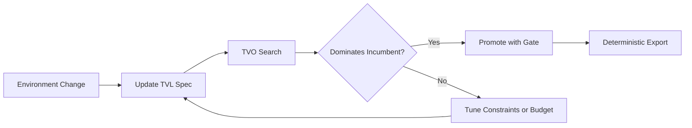

# TVL Intelligent Textbook

Welcome to the **Tuned Variables Language (TVL)** interactive guide. This learning path adapts the core TVL
book from Traigent Labs to the interactive framework provided by the Intelligent Textbooks project. You can
read chapters sequentially, explore examples in your editor, or remix the content into your own courseware.

!!! tip "How to Use This Track"
    1. Skim the chapter overviews to decide where to dive in.
    2. Open the linked code samples directly from the repository for hands-on practice.
    3. Re-run the exercise scripts to validate your understanding before moving on.

## Why TVL Matters

Large language model (LLM) applications operate in environments where models, latencies, and costs shift daily.
TVL turns brittle configuration files into governed, type-safe specifications. An optimizer such as TVO (the TVL
Optimizer in the Traigent platform) searches the declared space. Separate checks test configurations against the
declared domains and constraints, and the TVL promotion gate decides from measurement evidence, under the module's
promotion policy, whether a candidate may replace the incumbent. This textbook guides software engineering students through that mindset
shift—from hard-coded parameters to adaptive, auditable configuration for agents, services, and other LLM-backed workflows.

## Chapter Map

| Chapter | Focus | Key Artifacts |
|---------|-------|---------------|
| [Motivation](chapter-01-motivation.md) | Why prone-to-drift pipelines need TVL | Baseline campus RAG spec |
| [Language Basics](chapter-02-basics.md) | Anatomy of a TVL spec | Quickstart YAML + Python inspector |
| [Constraints & Units](chapter-03-constraints.md) | Declarative constraints in typed DNF, checked with SAT/SMT tools | Constraint lab spec + pytest |
| [Patterns](chapter-04-patterns.md) | Inheritance, overlays, and hotfixes | Environment tree + overlay YAML |
| [Integration](chapter-05-integration.md) | TVL with external tools: TVO (Traigent's optimizer) and DVL | Deployment manifest + CI script |
| [Requirements in Production](chapter-06-requirements-in-production.md) | TVL 1.3 (accepted; still valid in TVL 1.5): requirements, monitors and responses after release | Campus latency module, organisation floor pack |
| [Resources](resources.md) | Commands, references, and next steps | Tooling cheat sheet |
| [Hands-on Labs](labs.md) | Run Traigent examples aligned with the chapters | Hello World, Tradeoffs, Guardrails |
| [Guided Walkthrough](walkthrough.md) | Step-by-step SDK tour | `walkthrough.sh` script |
| [Playground](playground.md) | Streamlit control center for experiments | Problem manager + visualizations |

## Hands-On Materials

- **Primary specs** live in `tvl_book/examples/*.tvl.yml`
- **Helper scripts** sit beside each spec (look for `.py` or `.sh` neighbors)
- **Deployment assets** flow through `tvl_book/examples/ch5_*`

You can open these files in your IDE and run the scripts locally while following the chapters.

## Tooling Overview

Validation and linting run through separate commands: `tvl-parse`, `tvl-lint`, `tvl-validate`,
`tvl-check-structural`, `tvl-ci-gate`, and friends (there is no single `tvl` command). Scan the
[Resources](resources.md) page for a command cheat sheet, then wire these commands, or their Python modules
(`tvl_tools.tvl_validate` and so on), into your local scripts or CI pipeline. An integration such as Traigent can
consume the same reports before promoting a configuration.
